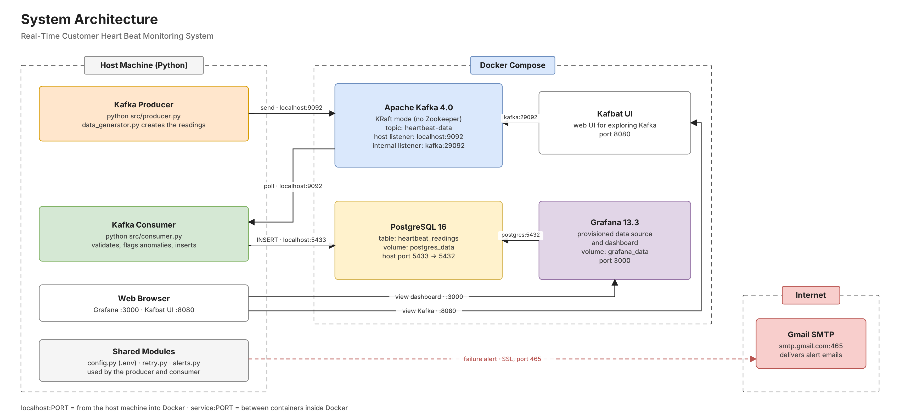
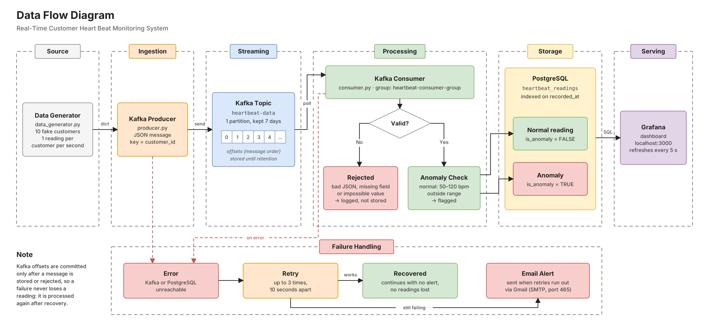
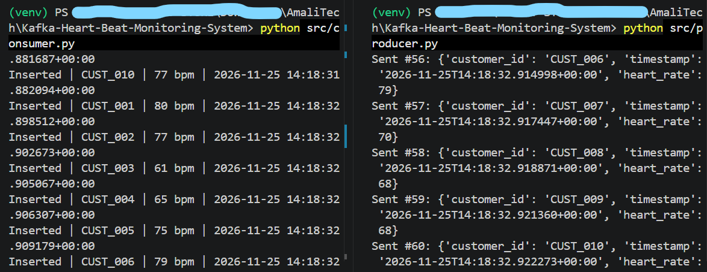
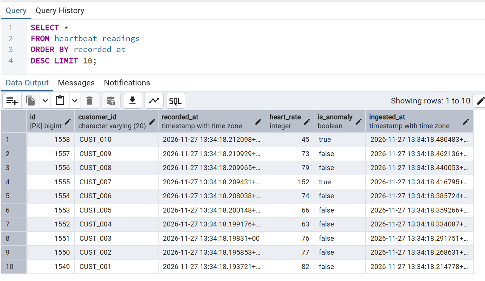
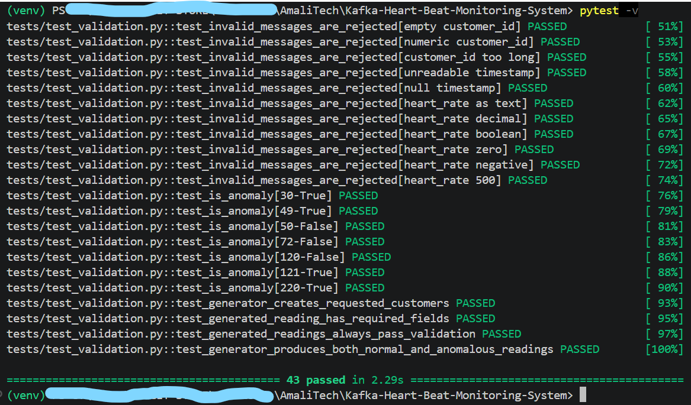
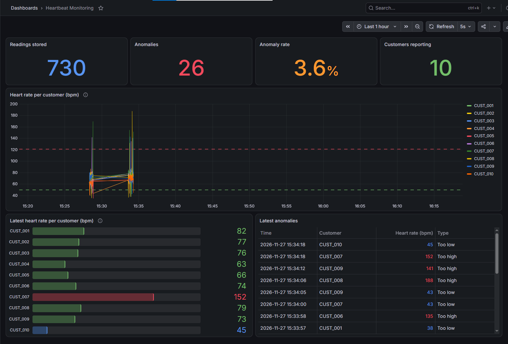
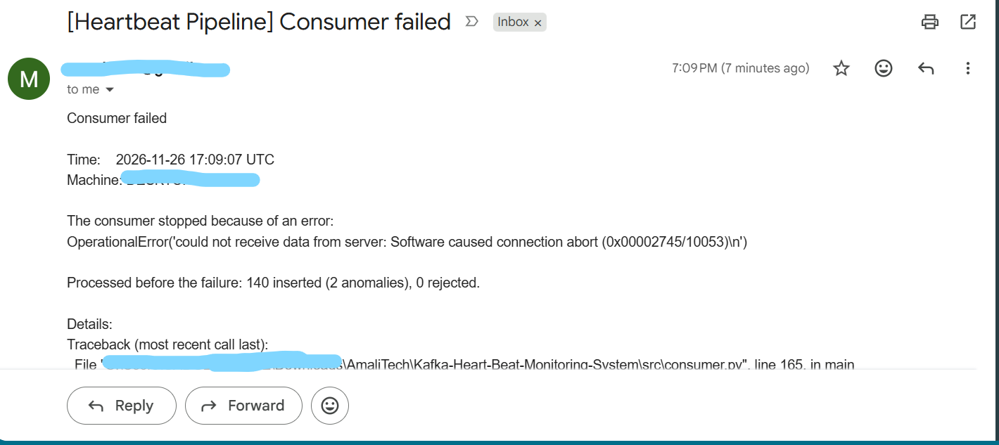

# Real-Time Customer Heart Beat Monitoring System

A data pipeline that simulates heart rate monitors for multiple customers, streams the readings through **Apache Kafka**, validates them and flags anomalies in a Python consumer, stores them in **PostgreSQL**, and displays them live on a **Grafana** dashboard. If the pipeline fails, it retries automatically and sends an **email alert** when the retries run out.

```
Data Generator → Kafka Producer → Kafka Topic → Kafka Consumer → PostgreSQL → Grafana
                                                     │
                                       validates readings, flags anomalies,
                                       retries on failure, emails alerts
```

## Project Deliverables

| Deliverable | Link |
|---|---|
| Project Description (Requirements) | [Project-Description.md](Project-Description.md) |
| Synthetic data generator | [src/data_generator.py](src/data_generator.py) |
| Kafka producer | [src/producer.py](src/producer.py) |
| Kafka consumer | [src/consumer.py](src/consumer.py) |
| Database schema (SQL) | [sql/schema.sql](sql/schema.sql) |
| Docker Compose file | [docker-compose.yml](docker-compose.yml) |
| Setup guide and documentation | [Setup Guide](#setup-guide) and [How It Works](#how-it-works) |
| Architecture diagram | [docs/images/architecture-diagram.png](docs/images/architecture-diagram.png) |
| Data flow diagram | [`docs/images/data-flow-diagram.png`](docs/images/data-flow-diagram.png) |
| Test scripts | [`tests/`](tests/) |
| Sample outputs and screenshots | [Screenshots](#screenshots) and [`docs/images/`](docs/images/) |
| Dashboard (optional extension) | [`grafana/dashboards/heartbeat.json`](grafana/dashboards/heartbeat.json) |
| Email alerts with retries (additional feature) | [`src/alerts.py`](src/alerts.py) and [`src/retry.py`](src/retry.py) |

## Contents

1. [Architecture](#architecture)
2. [Data Flow](#data-flow)
3. [Tech Stack](#tech-stack)
4. [Project Structure](#project-structure)
5. [Setup Guide](#setup-guide)
6. [How It Works](#how-it-works)
7. [Testing](#testing)
8. [Screenshots](#screenshots)
9. [Troubleshooting](#troubleshooting)
10. [Design Decisions](#design-decisions)
11. [Possible Improvements](#possible-improvements)

---

## Architecture



The Python scripts run on the host machine, and the infrastructure runs in Docker:

| Component | Where it runs | Role |
|---|---|---|
| Kafka Producer | Host machine | Generates readings and sends them to Kafka |
| Kafka Consumer | Host machine | Reads messages, validates them, flags anomalies, writes to PostgreSQL |
| Apache Kafka 4.0 | Docker | Message broker holding the `heartbeat-data` topic (KRaft mode) |
| PostgreSQL 16 | Docker | Stores validated readings in the `heartbeat_readings` table |
| Grafana 13.3 | Docker | Live dashboard that queries PostgreSQL every 5 seconds |
| Kafbat UI | Docker | Optional web UI for exploring Kafka topics, messages and consumer lag |
| Gmail SMTP | Internet | Delivers failure alert emails |

Programs on the host machine reach the containers through `localhost` ports (Kafka on `9092`, PostgreSQL on `5433`). Containers reach each other by service name on Docker's internal network (Grafana uses `postgres:5432`, Kafbat UI uses `kafka:29092`).

## Data Flow



1. **Source:** the data generator creates 10 fake customers, each with their own resting heart rate, and produces one reading per customer per second.
2. **Ingestion:** the producer converts each reading to JSON and sends it to Kafka, using the customer ID as the message key.
3. **Streaming:** Kafka stores the messages in order in the `heartbeat-data` topic.
4. **Processing:** the consumer reads each message and validates it. Invalid messages are logged and skipped. Valid readings are checked against the normal range and flagged as anomalies if they fall outside it.
5. **Storage:** valid readings are inserted into PostgreSQL with an `is_anomaly` flag.
6. **Serving:** Grafana queries the table and displays the data live.

If the producer or consumer hits an error (for example, PostgreSQL goes down), it retries up to 3 times, 10 seconds apart. If the problem clears, it continues with no alert. If every retry fails, it sends an email alert and stops.

## Tech Stack

| Tool | Purpose |
|---|---|
| Python 3.14 | Data generator, producer, consumer, alerts, tests |
| Apache Kafka 4.0 | Real-time message streaming |
| PostgreSQL 16 | Time-series storage |
| Grafana 13.3 | Real-time dashboard |
| Docker Compose | Runs Kafka, PostgreSQL, Grafana and Kafbat UI locally |
| pytest | Unit and end-to-end tests |
| kafka-python, psycopg2, python-dotenv | Python libraries for Kafka, PostgreSQL and settings |

## Project Structure

```
Kafka-Heart-Beat-Monitoring-System/
├── docker-compose.yml          # Kafka, Kafbat UI, PostgreSQL, Grafana
├── requirements.txt            # Python dependencies
├── pytest.ini                  # pytest settings
├── .env.example                # Template for the .env settings file
├── .gitignore
├── README.md
├── Project Description.md      # Original project brief
├── sql/
│   └── schema.sql              # Table and index definitions
├── src/
│   ├── config.py               # Loads all settings from .env
│   ├── data_generator.py       # Creates realistic heart rate readings
│   ├── producer.py             # Sends readings to Kafka
│   ├── consumer.py             # Validates, flags anomalies, writes to PostgreSQL
│   ├── retry.py                # Airflow-style retries before alerting
│   └── alerts.py               # Email alerts through Gmail
├── tests/
│   ├── test_validation.py      # Validation, anomaly detection, generator
│   ├── test_alerts.py          # Email alerts (with a fake mail server)
│   ├── test_retry.py           # Retry logic
│   └── test_pipeline.py        # End-to-end: Kafka → consumer → PostgreSQL
├── grafana/
│   ├── provisioning/
│   │   ├── datasources/postgres.yml   # PostgreSQL connection
│   │   └── dashboards/dashboards.yml  # Where to load dashboards from
│   └── dashboards/heartbeat.json      # The dashboard itself
└── docs/
    └── images/                 # Diagrams and screenshots
```

---

## Setup Guide

Commands are for **Windows PowerShell**. Notes for macOS and Linux are included where the commands differ.

### Prerequisites

- **Docker Desktop**, installed and running
- **Python 3.11 or newer** (developed and tested with Python 3.14)
- **Git**
- A **Gmail account** with 2-Step Verification, if you want email alerts (optional)

### 1. Clone the repository

```powershell
git clone https://github.com/Molo-M/Kafka-Heart-Beat-Monitoring-System
cd Kafka-Heart-Beat-Monitoring-System
```

### 2. Create a virtual environment and install dependencies

```powershell
python -m venv venv
.\venv\Scripts\Activate.ps1
pip install -r requirements.txt
```

On macOS or Linux, activate with `source venv/bin/activate`.

If PowerShell says running scripts is disabled, run `Set-ExecutionPolicy -Scope CurrentUser -ExecutionPolicy RemoteSigned` once, then activate again.

### 3. Create your settings file

```powershell
Copy-Item .env.example .env
```

On macOS or Linux: `cp .env.example .env`. Then open `.env` and adjust it:

| Setting | What to set |
|---|---|
| `POSTGRES_PASSWORD` | Any password for the database |
| `POSTGRES_PORT` | `5432`, or `5433` if PostgreSQL is also installed directly on your computer |
| `GRAFANA_ADMIN_PASSWORD` | Your password for the Grafana website |
| `ALERT_EMAIL_SENDER` / `ALERT_EMAIL_RECIPIENT` | Your Gmail address (can be the same) |
| `ALERT_EMAIL_PASSWORD` | A Gmail **App Password** (see below). Leave empty to turn alerts off. |
| `PIPELINE_RETRIES` / `PIPELINE_RETRY_DELAY_SECONDS` | How many retries before alerting, and the wait between them |
| `NUM_CUSTOMERS` / `SEND_INTERVAL_SECONDS` | How many fake customers, and how often each sends a reading |

**Set the passwords before the first `docker compose up`.** PostgreSQL and Grafana only read their passwords the first time they start. See [Troubleshooting](#troubleshooting) if you change them later.

**Gmail App Password:** with 2-Step Verification turned on, go to [myaccount.google.com/apppasswords](https://myaccount.google.com/apppasswords), create a password named `Heartbeat Pipeline`, and paste the 16-character code into `ALERT_EMAIL_PASSWORD`. Never use your normal Google password. Check the setup by sending a test email:

```powershell
python src/alerts.py
```

### 4. Start the infrastructure

```powershell
docker compose up -d
docker compose ps
```

All four containers (`kafka`, `kafka-ui`, `postgres`, `grafana`) should be running. The database table is created automatically from `sql/schema.sql` the first time PostgreSQL starts.

### 5. Create the Kafka topic

```powershell
docker exec -it kafka /opt/kafka/bin/kafka-topics.sh --create --topic heartbeat-data --bootstrap-server kafka:29092 --partitions 1 --replication-factor 1
```

### 6. Run the pipeline

Open two terminals, activate the virtual environment in each, then start the consumer in the first:

```powershell
python src/consumer.py
```

And the producer in the second:

```powershell
python src/producer.py
```

The producer prints each reading it sends, and the consumer prints each reading it stores, marking anomalies and rejected messages. Stop either with `Ctrl+C`.

### 7. Open the dashboards

| Web UI | Address | Login |
|---|---|---|
| Grafana dashboard | http://localhost:3000 | `admin` / your `GRAFANA_ADMIN_PASSWORD` |
| Kafbat UI | http://localhost:8080 | none |

In Grafana, open **Dashboards → Heartbeat Monitoring**.

### Stopping and starting

| Command | Effect |
|---|---|
| `docker compose stop` / `docker compose start` | Pause and resume. Keeps everything. |
| `docker compose down` | Removes the containers. PostgreSQL and Grafana data are kept, but **Kafka's topic and messages are deleted**, so recreate the topic (step 5) afterwards. |
| `docker compose down -v` | Removes everything, including all stored data. |

---

## How It Works

### Data generator (`src/data_generator.py`)

Each fake customer gets a resting heart rate between 62 and 80 bpm. Normal readings are drawn from a bell curve centred on that rate (`random.gauss(resting_rate, 4)`), so they stay realistic from second to second instead of jumping around randomly. About 5% of readings are anomalies: either too high (130 to 190 bpm) or too low (35 to 45 bpm). These are physically possible values, so the consumer has to flag them rather than reject them.

Each reading has the three fields required by the project:

```json
{"customer_id": "CUST_001", "timestamp": "2026-11-25T10:15:03.123456+00:00", "heart_rate": 71}
```

### Producer (`src/producer.py`)

The producer sends one reading per customer per second to the `heartbeat-data` topic. Each message's **value** is the reading as JSON, and its **key** is the customer ID. Kafka sends messages with the same key to the same partition, so each customer's readings stay in order even if partitions are added later. After each round of sends, the producer waits for Kafka to confirm delivery, and treats any failed delivery as an error.

### Consumer (`src/consumer.py`)

The consumer reads each message and applies these rules:

| Heart rate | Meaning | Result |
|---|---|---|
| Below 30 or above 220 | Impossible or broken data | **Rejected**: logged, not stored |
| 30–49 or 121–220 | Real but worrying | **Stored** with `is_anomaly = TRUE` |
| 50–120 | Normal | **Stored** with `is_anomaly = FALSE` |

Messages are also rejected if they aren't valid JSON, are missing a field, have an empty or overlong customer ID, an unreadable timestamp, or a heart rate that isn't a whole number.

The consumer commits its Kafka **offset** (its position in the topic) only **after** a message has been stored or rejected. If it crashes mid-message, that message is delivered again on restart, so no reading is lost.

### Database (`sql/schema.sql`)

| Column | Type | Description |
|---|---|---|
| `id` | `BIGSERIAL` | Unique row ID |
| `customer_id` | `VARCHAR(20)` | Customer, e.g. `CUST_001` |
| `recorded_at` | `TIMESTAMPTZ` | When the reading was measured (the message's `timestamp` field) |
| `heart_rate` | `INTEGER` | Beats per minute, with a `CHECK` constraint as a last safety net |
| `is_anomaly` | `BOOLEAN` | Whether the reading is outside the normal range |
| `ingested_at` | `TIMESTAMPTZ` | When the row was written to the database |

Two indexes keep queries fast as the table grows: one on `recorded_at` for time-based queries, and one on `(customer_id, recorded_at)` for per-customer queries.

### Retries and alerts (`src/retry.py`, `src/alerts.py`)

The retry logic follows Airflow's `retries` and `retry_delay` settings. When the producer or consumer hits an unexpected error, it retries up to `PIPELINE_RETRIES` times, waiting `PIPELINE_RETRY_DELAY_SECONDS` between attempts. Each retry reconnects from scratch, and the consumer resumes from its last committed offset. Only when every retry fails is an email alert sent, with the error details. Because the scripts run continuously, the retry count resets whenever an attempt makes progress, so a failure after hours of normal running gets a fresh set of retries.

Rejected messages and anomalies are **not** failures; they're the pipeline working correctly, so they never trigger alerts.

### Dashboard (`grafana/`)

Grafana is set up automatically through **provisioning**: `postgres.yml` creates the database connection, and `heartbeat.json` defines the dashboard. The dashboard shows four summary numbers (readings, anomalies, anomaly rate, customers reporting), heart rate per customer over time with the normal range marked, each customer's latest reading coloured by status, and a table of the latest anomalies. It refreshes every 5 seconds, and every query is filtered by the selected time range on the indexed `recorded_at` column.

---

## Testing

The project has 43 tests:

| File | Tests | What it checks | Needs Docker? |
|---|---|---|---|
| `test_validation.py` | 30 | Validation of 17 kinds of bad messages, anomaly boundaries (49/50, 120/121), generator output | No |
| `test_alerts.py` | 3 | Alert email content, missing settings, email failures never crash the script | No |
| `test_retry.py` | 5 | Recovery within retries, one alert after all retries fail, progress resets the count, `Ctrl+C` isn't retried | No |
| `test_pipeline.py` | 5 | End to end: sends normal, anomalous and invalid readings through Kafka and checks exactly the right rows reach PostgreSQL | Yes |

Run the unit tests (no Docker needed):

```powershell
pytest tests/test_validation.py tests/test_alerts.py tests/test_retry.py -v
```

Run everything, including the end-to-end test. This needs the containers running **and the consumer running in another terminal**:

```powershell
pytest -v
```

The end-to-end test uses customer IDs with a unique prefix for each run (such as `T3fa9c1_NORMAL`) and deletes its rows from the database afterwards.

**A note on production.** The end-to-end test sends real messages through the pipeline, which is fine for a local or staging environment but not for production, where test data would mix with real data. In production, the same tests would run against a separate staging environment (the code supports this through `.env`, with no code changes), and the live system would be watched through monitoring instead: failure alerts, consumer lag, and data quality checks such as "no readings in the last 5 minutes."

---

## Screenshots

**Producer and consumer running**



**Database showing successful ingestion**, including two flagged anomalies (45 and 152 bpm)



**All 43 tests passing**



**Grafana dashboard with live data**



**Email alert after all retries failed**, during a test where PostgreSQL was stopped



Note: PostgreSQL stores and displays times in UTC, while Grafana shows them in the browser's local time zone, so the same reading can appear with different clock times in the two screenshots.

---

## Troubleshooting

**`password authentication failed` from the consumer, or the Grafana login is rejected.**
PostgreSQL and Grafana only use the passwords in `.env` the first time they start. If a password is changed in `.env` afterwards, it has to be updated inside the service as well:

```powershell
# PostgreSQL: set the password to match .env
docker exec -it postgres psql -U heartbeat_user -d heartbeat_db -c "ALTER USER heartbeat_user WITH PASSWORD 'new-password';"

# Grafana: reset the admin password
docker exec -it grafana grafana cli admin reset-admin-password new-password
```

**The consumer connects to the wrong PostgreSQL.**
If PostgreSQL is also installed directly on the host machine, it may already be using port 5432. Set `POSTGRES_PORT=5433` in `.env` and run `docker compose up -d`.

**The topic is missing.**
`docker compose down` deletes Kafka's data. Recreate the topic with the command in step 5, or use `docker compose stop` / `start` to keep it.

**`test_pipeline.py` fails after 30 seconds.**
The consumer must be running in another terminal during this test. If the test ran without it, its messages stay in Kafka and get stored the next time the consumer starts. Remove those leftover rows with:

```sql
DELETE FROM heartbeat_readings WHERE customer_id NOT LIKE 'CUST\_%';
```

**No alert email arrives.**
Running `python src/alerts.py` sends a test email to check the settings. Alerts can also land in the spam folder. "Username and Password not accepted" means the App Password or sender address in `.env` is wrong.

---

## Design Decisions

- **KRaft instead of Zookeeper.** The project brief mentions Zookeeper, but Kafka 4.0 removed it entirely; Kafka now manages its own metadata in KRaft mode. This also means one fewer container to run.
- **`recorded_at` instead of `timestamp`.** The message field is called `timestamp`, as the brief specifies, but the database column is named `recorded_at`, because `timestamp` is also a SQL data type and would make queries confusing. The consumer maps one to the other.
- **Two layers of validation.** The consumer does the real validation, and the database's `CHECK` constraint guarantees nothing impossible is stored even if a bug lets something through.
- **Manual offset commits.** Automatic commits could mark a message as done before it was stored. Committing manually after each message is handled means failures cause a retry, never data loss.
- **Measurement time on the dashboard.** Grafana plots `recorded_at`, not `ingested_at`, so readings delayed by an outage still appear at the time they were measured, filling the gap once the consumer catches up.
- **All settings in `.env`.** No connection details or passwords are written in the code, so the same code can run against a different environment just by changing `.env`.

## Possible Improvements

- Give Grafana a **read-only database user**, as Grafana's documentation recommends, instead of sharing the consumer's user.
- Add a **Docker volume for Kafka**, so the topic and messages survive `docker compose down`.
- Run the tests automatically on every push with **GitHub Actions**, against temporary containers.
- Add **data quality checks**, such as alerting when no readings arrive for 5 minutes, or when the rejection rate spikes.
- For long dashboard time ranges, **aggregate in SQL** (for example, average per minute with Grafana's `$__timeGroup` macro) so charts stay fast as the table grows.